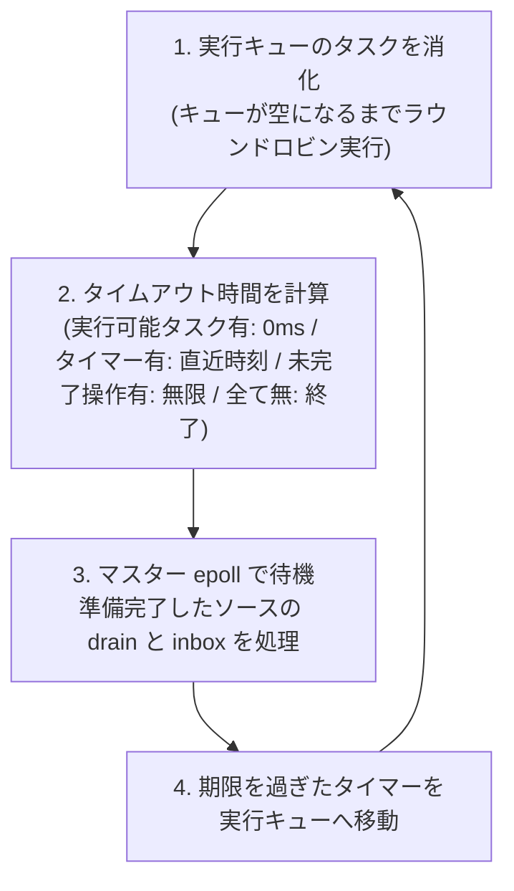

# `Control.Task`: epoll による協調的タスク管理

> **ステータス**: マイルストーン 1 から 3 まで、すべて実装済みです（末尾の「マイルストーン」を参照）。
> - **マイルストーン 1**: 単一スレッドのスケジューラと、`epoll`・`io_uring` のソース（`Control.Task`, `Control.Task.Source`, `Control.Task.Epoll`, `Control.Task.Scheduler`, `Control.Task.Uring`）
> - **マイルストーン 2**: termui からの利用（`RunTask` など）
> - **マイルストーン 3**: N:M。`blocking`、ワーカープール、並列モード、状態を共有するタスクのための `Ref`・`MVar`・`Chan`
>
> 未実装のものは「未解決の点（Open points）」にまとめてあります。以下の記述で初期スケッチとコードが異なる箇所はその旨を明記しています。

---

## 1. 動機 (Motivation)

複数の入出力を同時に待ち受けるプログラム（端末・ソケット・タイマーを同時に扱うUIや、多数の接続を処理するサーバーなど）では、複数の論理的な実行スレッド（制御フロー）が必要となります。しかし、そのすべてにOSスレッドを1対1で割り当てるのはリソース面で好ましくありません。

`Task` モナドは、こうした論理スレッドを通常のモナドコードとして記述できるようにします。スケジューラは、単一のOSスレッド上で多数のタスクを動かすことも、少数のワーカースレッド群（N:Mスレッドモデル）を使うこともできます。

本モデルは [idris2-coop](https://github.com/buzden/idris2-coop)（「並行性はあるが並列性はない」モデル）に基づいています。計算は `>>=`, `zip`, `race`, `spawn` によって構築される**データ構造**であり、インタプリタがそれを1ステップずつ実行していきます。

### idris2-coop との比較

| 項目 | idris2-coop | `Control.Task` |
|---|---|---|
| **基盤モナド (Substrate)** | 任意のモナド `m` (`Coop m a`) | `IO` (`Task a`) に固定 |
| **待機処理 (Waiting)** | モデルまたは実時間クロックの `sleepTill` | 任意の非同期操作 (`Async`): `epoll` の準備完了通知とタイマー、`io_uring` 等 |
| **`zip` の合流 (Join)** | マップ内に保持されたペアへの `believe_me` | 型付けされた2つの `IORef` |
| **`race` によるキャンセル** | 競合する同期待ちのイベントを削除 | レースごとの**スコープ**とクリーンアップ処理 |
| **スレッド** | なし（完全シングルスレッド） | 1つのスケジューラスレッド、またはワーカー付きのN:M（`runTaskWith n`、マイルストーン3） |

`Task` が `IO` に固定されている理由は、スケジューラが `epoll`, `IORef`, そしてスレッドを利用するためであり、これらは任意のモナド `m` では提供できないからです。将来的には基盤を任意の `HasIO m`（`TaskT m` とし、`Task` を `TaskT IO` とする）に拡張することが望まれています。タスクの作用は `Point`（`IO` アクション）とデータ型のコンストラクタのみであり、スケジューラの型が意識すべき `IO` 利用は存在しないため、この設計を妨げるものはありません。

---

## 2. データ型 (The data type)

```idris
data Task : Type -> Type where
  Point       : IO a -> Task a                        -- 完了まで実行されるアクション（並列モードではワーカーで実行）
  Pinned      : IO a -> Task a                        -- Pointと同じだが、常にスケジューラスレッド上で実行
  PointThen   : IO a -> (a -> Task b) -> Task b       -- Pointとその継続（>>= が Point に対して生成するもの）
  Seq         : Task a -> (a -> Task b) -> Task b     -- >>= による逐次実行
  Both        : Task a -> Task b -> Task (a, b)       -- zip: 並行して実行し、両方の完了を待つ
  Race        : Task a -> Task a -> Task a            -- 先に終わった方が勝ち、もう片方はキャンセルされる
  Spawn       : Task () -> Task ()                    -- 後続の処理と並行してバックグラウンド実行
  Async       : (Env -> Completion a -> IO Cancel) -> Task a        -- 非同期操作を開始してその完了を待つ
  Handoff     : (Env -> Completion a -> IO Cancel) -> (a -> IO ()) -> Task a -- タスク破棄時に値が返却・回収されるAsync
  Finally     : (Maybe b -> IO ()) -> Task b -> Task b -- 終了時(Just)または中断時(Nothing)に実行される後処理
  SpawnOwning : IO () -> Task () -> Task ()         -- 開始前に破棄された場合の後処理を持つSpawn
  Map         : (a -> b) -> Task a -> Task b             -- fmap（タスク終了ステップ内で直接実行）
  Empty       : Task a                                -- 決して完了しないタスク

Completion a = a -> IO ()      -- 操作が完了したことをスケジューラに通知するコールバック
data Cancel = MkCancel (IO ())   -- 操作を取り消すためのアクション（裸の IO () ではなく専用の型）
```

- **`Env`**: スケジューラが提供する環境。`now`（現在時刻）、`addTimer`（タイマー登録）、`watchFd`（FD監視）、`post`（スケジューラスレッド上でのアクション実行。任意のスレッドから安全に呼び出せる唯一の関数）を提供します。
- **`Cancel`**: 専用の型としてラップされています。`IO Cancel` を「値を返すアクション」とすることで、単なる `IO ()` だった場合に発生していた健全性の問題（詳細は `rc2/doc/world-arity-raising.md` の "Soundness" を参照）を防いでいます。

### `Async`: 待機の唯一のプリミティブ

`Async` は**待機 (waiting)** を行うための唯一の基本プリミティブです。
1. 提供された関数が操作を開始し（ディスクリプタの登録、リクエストのキューイング、タイマーの設定など）、即座に戻ります。
2. 後で操作が完了したとき、何らかの処理が結果とともに `Completion` を呼び出し、タスクが再開されます。
3. 完了前にタスクのスコープがキャンセルされた場合、返された `Cancel` が実行されます。このキャンセル処理は操作を無害化（監視集合からディスクリプタを除去、カーネルにキャンセルを要求、タイマーを破棄など）しなければなりません。キャンセル後に `Completion` が呼ばれても何も起きません。

`Task` 内部は `epoll` を直接知りません。準備完了通知API（Ready型）も完了通知API（`io_uring`、ブロッキング呼び出しを行うスレッドプール、コールバック方式のライブラリ）も、すべてこの `Async` 抽象の上で同等に扱われます。

### `Async` 上に構築された待機関数群

```idris
sleepFor, sleepTill          : ... -> Task ()                -- スケジューラのタイマーによる待機
awaitReadable, awaitWritable : FileDesc -> Task Ready         -- epollソースによるFD準備完了待機
-- 他のモジュール（Control.Task.Uring など）での例:
uringRead : FileDesc -> Buffer -> Bits32 -> Bits64 -> Task (Either Errno Nat)
```

- **`Ready`**: `EPOLLIN`, `EPOLLOUT`, `EPOLLERR`, `EPOLLHUP` のいずれが発生したかを示します（エラーやハングアップでも待機側が起床します）。
- **モナド関連のインスタンス**: `Monad`, `Applicative`（逐次実行。coop と同様に `<*>` は `>>=`）、`HasIO` (`liftIO = Point`)、`Alternative` (`<|>` = `Race`) が実装されています。並行な `Applicative` は `Concurrent` という名前付きインスタンスとして提供されます（`a *> b` が常に「a の後に b」を意味する必要があるため）。
- **その他の便利関数**:
  - `both` (`Both`)
  - `race : Task a -> Task b -> Task (Either a b)`
  - `spawn`, `yield`, `forever`
  - `now`（スケジューラのクロック時刻。`runTaskVirtual` では仮想時刻）
  - `timeoutAt : Time -> Task a -> Task (Maybe a)`: `sleepTill` に対する `race` であり、敗者は取り消されます。一度決めた締め切り時刻を複数の待機処理で共有できるため、リクエストごとのタイムアウト設定に適しています。

> [!WARNING]
> `Point` はスケジューラスレッド上で最後までブロッキング実行されます。そのため、`Point` 内でブロックする呼び出しを行うと**すべてのタスクが停止**してしまいます。待機には必ずノンブロッキングディスクリプタと `Async` を使用してください。

---

## 3. タスクの完了を待つ: プロミス (Promises)

`spawn` はタスクを開始してそのまま先へ進むため、その結果を待つ手段がありません。結果を待ち受けるには `fork` を使用します。

```idris
fork      : Task a -> Task (Promise a)    -- 並行してタスクを開始し、結果を受け取るプロミスを返す
wait      : Promise a -> Task a           -- 結果が得られるまで待機（既に完了していれば即座に取得）
waitMaybe : Promise a -> Task (Maybe a)   -- タスクが途中で破棄された場合は Nothing
peek      : Promise a -> Task (Maybe a)   -- 結果がすでにあれば取得、なければ Nothing
```

- 単一のプロミスに対して、任意の数のタスクが `wait` で待機できます（全タスクが結果を受け取ります）。
- 待機タスクが中断された場合（`race` で敗北した場合など）、そのタスクは待機者リストから除外されます。
- `fork` されたタスクが完了前に中断された場合（所属スコープが `race` や `cancelTask` によりキャンセルされた場合）、プロミスは**放棄 (abandoned)** されます。`waitMaybe` は `Nothing` を返し、`wait` は `Empty` のように永久に終了しなくなります（タイマーとの `race` でタイムアウトさせるのが脱出手段となります）。
- これはプロデューサ側のスコープに配置された番兵タスク（結果が格納されたら完了し、`Cancel` 時にプロミスを放棄する `Async`）によって実現されています。
- プロミスの内部状態は単純な `IORef` であり、すべての操作はスケジューラスレッドに固定 (`Pinned`) されているため、並列モードでもスレッドセーフです。

---

## 4. タスク間での状態共有: `Ref`, `MVar`, `Chan`

並列モードでは異なるタスクのアクションが同時に実行されるため、2つのタスクが通常の `IORef` を共有すると更新の衝突やロストが発生する危険があります。そのため、共有と待機のための3つのモジュールが用意されています。

これらの内部状態は、プロミスと同様にすべてスケジューラスレッド上でのみ操作されるため（スケジューラ上で開始する `Async` 内、または `onReactor` 経由）、並列モードでも安全であり、タスクの待機中にOSスレッドを一切消費しません。

- **`Control.Task.Ref`**: 単一セルの参照。`readRef`, `writeRef`, `modifyRef`, `atomicModifyRef`（アトミックな更新と結果取得を1ステップで実行）。
- **`Control.Task.MVar`**: 値を保持しているか空であるかの同期セル。
  - 空のときは `takeMVar` が待機し、満杯のときは `putMVar` が待機します。
  - `tryTakeMVar` / `tryPutMVar` は待機しません。
  - `modifyMVar`, `modifyMVar_`, `withMVar` は本体の処理中値を取り出すため、ミューテックスロックとして機能します。本体の終了前にタスクが中断された場合、**元の値がセルに戻される**ため、キャンセルによってセルが空のまま放置されることはありません（後述の `finally` による保証）。
- **`Control.Task.Chan`**: 指定したバッファ上限を持つチャネル。
  - 満杯のときは `send` が待機し、空のときは `recv` が待機します。
  - `trySend` / `tryRecv` は待機しません。
  - `close` を呼ぶと、内部に残っている値をすべて受信しきった後に `recv` が `Nothing` を返します。クローズされたチャネルへの `send` は `False` を返します。

待機中のタスクは到着順（FIFO）に処理されます（`Control.Task.Waiters`）。待機が中断された場合は列から離脱し、何も取得しません。すでにタスクに引き渡されたものの、そのタスクのスコープが処理を進める前にキャンセルされた場合、その値は適切に返却・回収されます（後述の `handoff`）。

---

## 5. 引き渡されたリソースを失わない仕組み (Not losing what is handed over)

完了通知（Completion）は、タスクの後続ステップ（継続）を**実行キューに入れるだけ**です。もしそのステップが実行される前にタスクのスコープがキャンセルされた場合（同ターン内で `race` に負けた場合など）、そのステップは破棄されてしまいます。

これにより、すでに引き渡されていた値やリソース（チャネルから取り出したメッセージ、取得したロック、新しく accept したファイルディスクリプタなど）が喪失する恐れがあります。非同期操作自体はすでに完了しているため、開始時の `Cancel` アクションを実行しても解決にはなりません。

そこで、準備完了ステップには**破棄された際に実行するアクション (`Step.drop`)** を保持できるようになっています（このアクションはスケジューラ終了時にキューに残っていたステップに対しても実行されます）。以下の3つのコンストラクタがこれを活用しています。

```
              【リソースのライフサイクルと保護】
[非同期操作完了] ── complete x ──> [実行キューに格納]
                                        │
           ┌────────────────────────────┴────────────────────────────┐
           ▼                                                         ▼
     [正常に実行]                                               [ステップが破棄]
タスクが値 x を持って継続                                       undo x が自動実行！
                                                          (MVar返却 / ソケットclose等)
```

### 1. `handoff start undo`
値の安全な受け渡しを行う `Async` です。`complete x` は、破棄アクションとして `undo x` を設定した上で継続をキューに入れます。したがって、**「タスクが x を受け取って継続する」か「`undo x` が実行される」かのいずれか一方のみが確実に発生**します。操作キャンセル後に `complete` が呼ばれた場合や重複呼び出しの場合も `undo` が実行されます。
- `takeMVar`（undo: 値をセルに戻し、次の待機者がいれば渡す）
- `recv`（undo: チャネルの先頭にメッセージを戻す）
- `Network.Async.accept`（undo: ソケットをクローズする）
これらはすべて `handoff` を用いて実装されています。

### 2. `finally f t`
`t` を実行し、正常終了時には `f (Just result)` を、スコープが事前にキャンセルされた場合には `f Nothing` を呼び出します。このアクションは `t` の開始ステップでスコープのクリーンアップとして登録され、終了ステップで解除されます。
したがって、`Seq (handoff ...) (\x => finally (release x) body)` という構成にすることで、**「x を取得した瞬間」から「x の解放責任を持つ状態」への移行がわずか1ステップ（アトミック）で完結**します（`Seq` の継続は直前のタスクを完了させたステップ内でそのまま実行されるため）。`withSock` や `modifyMVar` はこのように記述されています。

### 3. `spawnOwning release t`
渡されたリソース（接続など）を所有するタスクのための `spawn` であり、タスクが一度も実行されずに破棄された場合に `release` を呼び出します。

### `Map` が独立したコンストラクタである理由
`map` は `Seq` と `pure` で合成するのではなく、専用のコンストラクタ `Map` として定義されています。もし `Seq` と `pure` で作ると、タスクの終了と関数適用の間に「キューに入った準備完了ステップ」が1つ挟まることになり、`race` が両辺を `map` で包んだ際にその隙間で値が破棄される危険があるためです。`Map` はタスクを終了させるステップの内部で直接結果を変換します。

> [!NOTE]
> タスクが一度値を持って実行を開始した後は、それ以降のステップがキャンセルされると保持している値が失われる可能性があります（Haskell で `mask` を使わずに `takeMVar` の直後に例外が発生した場合と同様）。長時間の処理でリソースを確実に保持し続けるには、常に `finally` を使用してください。

---

## 6. セマンティクス (Semantics)

- **`Seq`**: 左辺を実行し、続いてその継続を実行します。左ネストした結合は解釈時に右結合に再結合されるため（`Seq (Seq a f) g` は `Seq a (f >=> g)` に変換される）、`forever` や長いモナドバインドを行ってもコールスタックを消費しません。
- **`Both l r`**: `l` と `r` を2つのタスクとして開始し、結合セル（`IORef (Maybe _)` 2つ）を共有します。後から終了した方がもう一方の結果を見つけ、両者のペアを伴って後続の継続をスケジュールします。
- **`Race l r`**: 現在のスコープの下に新しい**子スコープ**を開き、その中で `l` と `r` を開始します。先に終了した方がスコープをキャンセルし、その中で実行されていたすべての処理（spawn されたものや内部のレースを含む）をキャンセルした上で、親スコープで後続処理を継続します。片方が `Empty` の場合、もう片方のタスクと同等になります。
- **`Spawn t`**: 現在のスコープ内で `t` を開始し、即座に先へ進みます。`t` は親の継続が終了した後も、所属するスコープがキャンセルされるまで実行を続けます（ルートスコープは決してキャンセルされません）。
- **スコープのキャンセル**: スコープのフラグを立て、登録された**クリーンアップ処理群**を実行します。キャンセルされたスコープのキューに入っているタスクは、取り出された時点で破棄されます。`Async` は `Cancel` アクションをスコープに登録しているため、非同期操作は破棄されます（epoll ソースの場合、待機リストから外れ、最後の1件であれば `epoll_ctl DEL` されます）。すでに開始された `Point` が中断されることはありません。
- **公平性 (Fairness)**: タスクは各 `Point` の実行後に実行キューの末尾へ戻されます。これにより、ループ処理を行うアクションが他のタスクを飢餓状態（スタベーション）にすることが防がれます（オーバーヘッドが大きい場合は、1ターンあたりのステップ数バジェットを導入することが検討されます）。

---

## 7. スケジューラとソース (The scheduler and its sources)

スケジューラは、実行キュー、スコープツリー、タイマー群、および**ソース (Source)** の集合から構成されます。ソースとは、非同期操作の完了を報告するあらゆる仕組みを指します。

```idris
record Source where
  constructor MkSource
  pollFd : FileDesc     -- 完了通知が存在するときに読み取り可能となるディスクリプタ
  drain  : IO ()        -- ブロックせずに完了通知を取り出し、対応する Completion を呼び出す処理
```

ディスクリプタの準備完了を監視する `epoll` は第1のソースであり、すべてのスケジューラが標準で備えています（`awaitReadable` はハンドル不要）。`io_uring` のリングも別のソースとなります（リングFDは完了エントリが存在するときに読み取り可能となり、`drain` はそれらを取り出して各エントリの `user_data` に保存された `Completion` を呼び出します）。

いずれも待機可能なディスクリプタであるため、スケジューラは各 `pollFd` を登録した1つの**マスター `epoll`** で一括待機でき、背後の詳細を気にする必要がありません。

ディスクリプタを提供できないソース（独自スレッドを持つCライブラリなど）は、そのスレッドから `Completion` を呼び出します。これにより、継続は実行キューではなくスケジューラの**受信箱 (Inbox)**（ロック付きキュー＋`eventfd`。この `eventfd` もマスター epoll の監視対象FDの1つ）に送られます。

```idris
record Scheduler where
  runQueue : Queue (Scope, Task ())                 -- 実行準備完了タスク
  timers   : IORef (SortedMap Time (Queue Timer))   -- 期限順にソートされたタイマー
  master   : EPoll                                  -- 各ソースの pollFd を監視する epoll
  sources  : IORef (List Source)
  inbox    : Inbox                                  -- 他スレッドからの完了通知受付
```

### イベントループの1ターン (One turn)



1. **実行キューのタスクを消化**: 実行キューが空になるまで実行準備完了タスクを動かします（実行中に新しく生成されたタスクもラウンドロビンで実行）。
2. **タイムアウト時間の算出**: 他に即座に実行できるものがあれば `0`、タイマーがあれば最も近いタイマーまでの時間、保留中の非同期操作があれば `-1`（無限待機）、何も残っていなければループを終了します。
3. **マスター epoll による待機**: `pollFd` が準備完了となったソースの `drain`、および受信箱（inbox）を処理します（完了通知によって後続タスクが実行キューに追加されます）。
4. **期限切れタイマーの移動**: 締め切りを過ぎたタイマーを実行キューに移動します。

タイマーはスケジューラ内部で `CLOCK_MONOTONIC` によるマップとして管理され、epoll 待機時のタイムアウト値としてそのまま使われます。個別の `timerfd` は生成されないため、1,000個のタスクがスリープしていてもディスクリプタは消費されません。分解能はミリ秒単位であり、待機が早く目覚めすぎないよう切り上げ計算されます。

### リソースとソースの動的確保 (`slot` と `addSource`)

`io_uring` リングのように、固有のリソースとソースを必要とする操作は、事前にスケジューラへ通知しておく必要はありません。`Async` に渡される `Env` の2つの関数でオンデマンドに管理されます。

```idris
env.slot      : (key : String) -> IO (Either Errno (a, IO ())) -> IO (Either Errno a)
env.addSource : Source -> IO (Either Errno Cancel)
```

- `slot`: 指定したキーに対応する値をスケジューラ内で1つだけ保持します。初回呼び出し時に生成アクションを実行し、解放用アクションも保持します。2回目以降はキャッシュされた同一の値を返します。解放処理はスケジューラ終了時に逆順で実行されます。
- `addSource`: 新しいソースを動的に登録し、登録解除用のアクション（`Cancel`）を返します。

初回のリング操作時に `slot` でリングを生成し、`addSource` でそのソースを登録するため、リングを使わないプログラムではリソースが一切確保されません。

---

## 8. 独自の非同期操作を実装する方法

すべての非同期操作は内部的には `Async` です。背後にある仕組みに応じて、以下の4通りのアプローチから選択します。

### パターン 1: `epoll` で待機できるディスクリプタ（ソケット、パイプ、pty、`libpq` 等）
ディスクリプタをノンブロッキングに設定し、`Task` 内で標準的なループを書きます。まず読み書きを試み、`EAGAIN` が返ったら `awaitReadable` / `awaitWritable` で待機して再試行します。手作業で `Async` を書く必要はありません。

```idris
readSome : FileDesc -> Nat -> Task (Either Errno (List Bits8))
readSome fd n = do
  r <- liftIO (readBytes fd n)
  case r of
    Left EAGAIN => awaitReadable fd *> readSome fd n
    other       => pure other
```

### パターン 2: ディスクリプタを持たずブロックする呼び出し（通常ファイル、SQLite、`fsync`）
通常のファイルは `epoll` が常に準備完了を返すため待機できません。`Point` で実行すると全タスクが停止してしまうため、ワーカースレッド上で実行します。

```idris
blocking : IO a -> Task a      -- 実装済み（マイルストーン3）
```

ワーカーがアクションを実行し、受信箱（inbox）を通じて `Completion` を呼び出します。開始前のリクエストはキャンセル可能です。開始後のリクエストは最後まで実行され、タスクがキャンセルされていた場合は結果が破棄されます。

### パターン 3: コールバック方式のライブラリ（libcurl multi インターフェース、`c-ares`）
`Source` を実装します。ライブラリが要求するディスクリプタ（およびタイマー）を登録し、`drain` の中でライブラリのイベント処理関数を呼び出してコールバックを実行させます。コールバック内から各タスクの `Completion` を呼び出します。

### パターン 4: その他すべて（低レベルな独自処理）
直接 `Async` を記述します。「操作の開始」「完了時に `done` を呼ぶこと」「中断用のアクションを返すこと」の3点を実装します。

```idris
myOp : Handle -> Task Reply
myOp h = Async $ \sched, done => do
  tag <- startRequest h (\reply => done reply)
  pure (cancelRequest h tag)
```

> [!IMPORTANT]
> **実装上の2つの鉄則**:
> 1. `done` はスケジューラスレッド上（`drain` から）、または受信箱経由で任意のスレッドから呼び出すこと。
> 2. キャンセル後に呼ばれた `done` は無視されますが、操作が使用しているバッファ等はキャンセル時点ではなく、カーネルやライブラリが**真に処理を完了するまで生存させ続けなければなりません**。

---

## 9. termui からの利用 (マイルストーン 2: 実装済み)

マスター `epoll` はディスクリプタであるため、別の `epoll` から監視できます。termui の `Loop` は自身の監視集合に `pollFd sched` を追加します（`watchFd`, イベント `EReady`）。読み取り可能になったらプログラムは `turn sched 0` を呼び出します。

ターンに仕事があるときに確実に読み取り可能となるよう、スケジューラは直近のタイマーに合わせて `timerfd`（ソースの1つ）を設定し、タスクが開始されたときやターンの終了時にまだ実行可能ステップが残っている場合は受信箱の `eventfd` に書き込みを行います。

```idris
RunTask    : Task msg -> Cmd msg             -- プログラムと並行してタスクを実行。終了時のメッセージを配送
RunTaskAs  : String -> Task msg -> Cmd msg   -- 同上。同名の実行中タスクがあれば先に中断する
CancelTask : String -> Cmd msg
```

タスクは `t >>= \m => Point (dispatch m)` のように実行されます（UIループのスレッド上で動くため、直接プログラムの dispatch を呼べます）。従来の `Perform` と異なり、タスクが待機中であってもUIループはブロックされず、タスク側でもソケット・タイマー・別タスクの待機が自由に行えます。

---

## 10. N:M スケジューリング (マイルストーン 3)

1つのスレッドである**リアクター (Reactor)** がスケジューラ全体（実行キュー、スコープ、結合セル、プロミス、タイマー、ソーステーブル）を所有します。これらに触れるのはリアクターのみであるため、内部状態は単純な非アトミック `IORef` のままで維持されます。

任意の数の**ワーカー (Worker)** スレッドは、リアクターから渡されたアクションを実行することだけを担当します。結果はスレッドセーフな `env.post`（受信箱）経由でリアクターに戻されます。Go や tokio のような「ワーカーごとに実行キューとポーラーを持つ」方式ではありません（すべてのデータ構造にロックが必要になってしまうため）。

```
        ┌─────────────────────────────────────────────────────────────┐
        │                 リアクタースレッド (Reactor)                 │
        │  ・実行キュー / スコープ / プロミス / タイマー (単一スレッド管理)│
        │  ・マスター epoll による監視                                 │
        └──────────────┬──────────────────────────────▲───────────────┘
                       │ アクション割り当て           │ 結果通知 (env.post / inbox)
                       ▼                              │
        ┌─────────────────────────────────────────────┴───────────────┐
        │                 ワーカースレッド群 (Workers)                │
        │  ・blocking アクションの実行                                 │
        │  ・並列モード時の Point (liftIO) の実行                      │
        └─────────────────────────────────────────────────────────────┘
```

### 実装ステージ

1. **`blocking` とスレッドプール（実装済み）**:
   - `blocking : IO a -> Task a` はワーカー上でアクションを実行し、ワーカーが受信箱に結果を入れた時点で完了します。
   - スケジューラ初期化時にワーカー数を指定します（`newSchedulerWith n`, `runTaskWith n`）。
   - ワーカーは最初のジョブが投入された際に**遅延起動 (lazily)** されます（最大 `n` 個）。最初のスレッドが起動すると、rc2 の参照カウント処理がプログラム全体でアトミック操作へと切り替わるため（`hybrid-refcount.md` 参照）、オフロードを行わないプログラムが無駄なコストを支払わないようにするためです。
   - `n = 0` の場合、アクションはスケジューラスレッド上で即座に実行されます（1:M、同じ結果）。
2. **ワーカー上での `Point` 実行（実装済み、オプトイン）**:
   - `runTaskParallel n`（またはスケジューラの `parallel` フラグ）により、スケジューラを**並列モード**に切り替えます。
   - `Point` (`liftIO`) は `blocking` と同様にワーカー上で実行され、タスクはその結果を持って継続します。同一タスク内のステップ順序は保たれますが、異なるタスクの `Point` は同時に並列実行されます。
   - 制御構造（`both`, `race`, `spawn`, `Async`, プロミス）は常にリアクターを経由するため、粒度の粗い重い `Point` に対してのみワーカーへのオフロードコストを支払います。
   - **`onReactor : IO a -> Task a`**（コンストラクタ `Pinned`）: 常にスケジューラスレッド上で実行される `Point` です。スケジューラやプログラムの状態に触れる処理のために使用します（`pure`, `yield`, プロミス操作, termui のメッセージ配信などは固定されています）。

#### パイプライン最適化: `PointThen`
ワーカーへの往復は小さなアクションの実行コストよりも高価です。もし `liftIO a >>= \x => liftIO (b x)` で2回の往復が発生すると非効率です。そのため、並列モードでの `>>=` は `Seq` ではなく `PointThen io f` を構築します。
ワーカーは `io` を実行した後、その場で `f a` を評価し、それが `Point` や `PointThen` である限り同じワーカー上でそのまま継続実行します（最大64ステップ連続、スコープがキャンセルされたら停止）。`Pinned` や `Both`, `Async` などに出会った時点でリアクターに制御を戻します。

### 2つの `liftIO` の間のコードで何をしてよいか？

並列モードでは、`>>=` 内の `liftIO` の後続関数は、アクションの直後に**ワーカー上で評価**されます。
このコードは、**純粋な計算（pure）であれば何を行っても安全**です（パース、フォーマット、受け取った値に基づく分岐、タスクを構築する関数の呼び出しなど）。

しかし、**プログラム全体で共有されている変数を直接読み書きしてはいけません**。他のスレッドとの順序関係が一切保証されておらず、スケジューラスレッド上でもないためです。

```idris
-- 【誤った例】
hits : IORef Nat  -- 全リクエストで共有

handler : Request -> Task Response
handler req =
  -- 誤り: タスク構築中にワーカー上で読まれており、他のリクエストとの同期がない
  let n = unsafePerformIO (readIORef hits)
  in liftIO (text 200 (show n))

-- 【正しい例】
hits : Ref Nat    -- Control.Task.Ref を使用

handler : Request -> Task Response
handler req = do
  -- 正しい: 読み取りと更新が1ステップのアトミック処理としてスケジューラ上で実行される
  n <- atomicModifyRef hits (\k => (S k, k))
  liftIO (text 200 (show n))
```

継続の中で安全に参照できるのは、引数として渡された値（`req` や直前のアクションの結果 `a`）およびプログラムのイミュータブルなデータ（起動時に作成された参照テーブル等）のみです。

---

## 11. テスト (Tests)

テストスイート `TestTask` は、マシンのスペックや実行速度に依存しない設計になっています。

1. **仮想クロック (`runTaskVirtual`)**:
   - タイマー（および実時間での応答を要しないパイプ等のディスクリプタ）のみを待つ処理は、仮想クロック上で実行されます。
   - クロックは 0 から始まり、実行可能なステップがなく、どのソースにもイベントがなく、タイマーだけが待機している状態になった瞬間に、**直近のタイマーの時刻まで一気にジャンプ**します。
   - `sleepFor 800` は実時間を一切消費せず、イベントの発生順序は厳密に保たれ、完了時刻を正確にアサーションできます。
2. **ジョブ待機フラグによる並行性検証**:
   - 実スレッドを必要とする処理（ワーカー、`blocking`、並列モード）は、経過時間ではなく**フラグを用いた同期待ち**でテストされます。
   - 例: 2つのジョブが `meet`（互いにフラグを立て、最大400ms相手のフラグを待つ）を行い、同時に並行実行された場合のみ両者が `True` を得られます。
3. **検証実績**:
   - 4コア環境でビジーループを4つ回しながら、40回連続実行および16並列同時実行を行い、すべて同一の出力を確認済み。ThreadSanitizer もパスしています。

---

## 12. io_uring (`Control.Task.Uring`)

`System.Linux.Uring` 上に構築され、`io_uring` リクエストを `Task` として提供します。

```idris
uringNop    : Task (Either Errno ())
uringRead   : FileDesc -> Buffer -> (nbytes : Bits32) -> (offset : Bits64) -> Task (Either Errno Nat)
uringWrite  : FileDesc -> Buffer -> (nbytes : Bits32) -> (offset : Bits64) -> Task (Either Errno Nat)
uringSend   : FileDesc -> Buffer -> (len : Bits64) -> (flags : Int32) -> Task (Either Errno Nat)
uringRecv   : FileDesc -> Buffer -> (len : Bits64) -> (flags : Int32) -> Task (Either Errno Nat)
uringAccept : FileDesc -> (flags : Int32) -> Task (Either Errno FileDesc)
uringConnect: FileDesc -> (host : String) -> (port : Bits16) -> Task (Either Errno ())
uringOpenat : Maybe DirDesc -> String -> (flags : Bits32) -> (mode : Bits32) -> Task (Either Errno FileDesc)
uringClose  : FileDesc -> Task (Either Errno ())
uringFsync  : FileDesc -> (flags : Bits32) -> Task (Either Errno ())
```

- リングの引き回しは不要です。各スケジューラは1つのリング（256エントリ）を持ち、初回リクエスト時に `Env.slot` で生成されて `Env.addSource` で登録されます。
- キャンセルされたリクエストは、カーネルに `IORING_OP_ASYNC_CANCEL` を要求します。完了通知が届くまでバッファは保持されます。

### liburing を不要にする設計
プログラムの `main` から到達可能なリクエストがない限り、liburing（Cコンパイル時のヘッダーや `-luring` リンク）は要求されません。
1. `Control.Task` の基本モジュール群は `Control.Task.Uring` をインポートしません。
2. rc2 のデッドコード除去により、到達不能な `%foreign` 宣言のヘッダー・ライブラリ要求はCコードから完全に排除されます。
3. リングは初回リクエスト実行時に初めて作られるため、`io_uring` 非対応カーネルでもインポートしただけでクラッシュすることはありません。

---

## 13. マイルストーン (Milestones)

1. **マイルストーン 1（実装済み）**: `Control.Task` と単一スレッドスケジューラ（epoll ソース、タイマー、テスト群、本ドキュメントの整備）。`Source` インターフェースを最初から備え、epoll ソースも特別扱いせずその一実装として構築。`io_uring` のソースは `Control.Task.Uring`。
2. **マイルストーン 2（実装済み）**: termui の `Cmd` における `Spawn`、ループ内での `pollFd` 監視、ハンドルによるキャンセル。
3. **マイルストーン 3（実装済み）**: N:M スケジューリング（ワーカースレッド、アトミック共有セル、`eventfd` キュー）。`blocking` とワーカープール、`onReactor` と `PointThen` を備えた並列モード、`eventfd` 上の受信箱、`Ref`・`MVar`・`Chan` が入っています。

---

## 14. 設計上の決定事項 (Decisions)

- `runTask` は coop と同様にタスクが何も残らなくなった時点で返ります。一方 `runTaskFirst n` は最初のタスクが終了した時点で残りを取り消して返ります。
- `Time` はモノトニッククロック上のミリ秒（`Nat`）です。`TimeSpec` を使うと、スケジューラが提供できない細かな分解能を約束してしまうことになるため避けています。
- 1ターンあたり最大1024ステップ実行（`stepBudget`）した後にソースの再確認を行います。1ステップのオーバーヘッドは約 0.74 マイクロ秒です。

---

## 15. 今後の検討課題 (Open points)

- `Task` を任意の `HasIO m` へ一般化すること（`TaskT m` の導入）。
- ソース自身が待機のタイムアウト値を提供できるようにするかどうか（`io_uring` 自前のタイムアウト操作など）。
- 複数のリングのサポート、256以外のキュー深度、およびマルチショット accept（1回のリクエストで複数回完了通知が来るもの）への対応。
